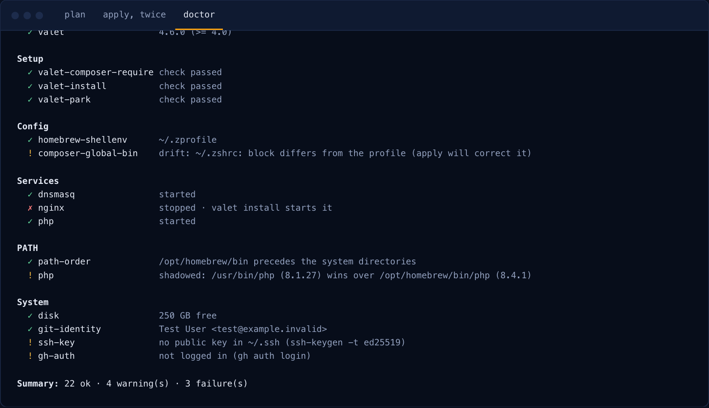
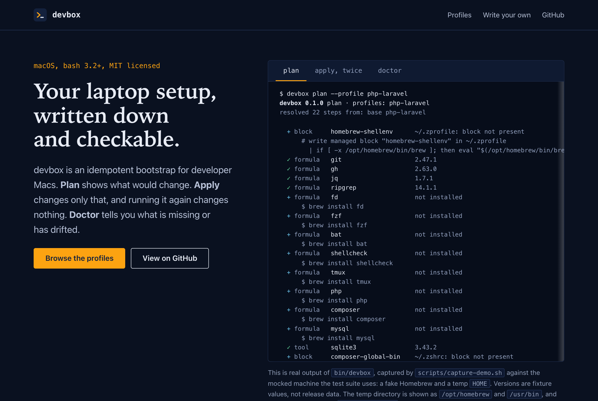
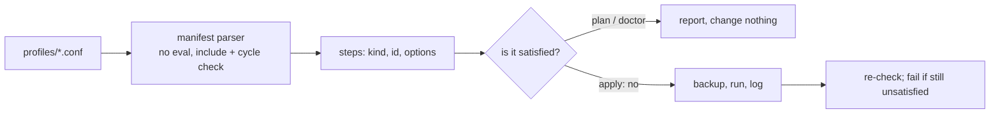

# devbox

**An idempotent, auditable macOS developer-machine bootstrap, with a `doctor` that tells you what is missing or has drifted.**

[](https://github.com/Victor-Wambua/devbox-bootstrap/actions/workflows/ci.yml)
[](LICENSE)


**Docs and profile catalogue: <https://victor-wambua.github.io/devbox-bootstrap/>**



> **Status: portfolio build.** Everything here is tested against a mocked machine (fake `brew`, `defaults`, `curl` and friends, a temp `$HOME`). It has **not** been run end to end on a clean Mac, so real installs and Laravel Valet's real behaviour are unverified. See [Status and limits](#status-and-roadmap).

## The problem

Setting up a new laptop takes a long time and nobody writes it down. Two people on one team end up with different PHP versions and different `PATH`s. When a laptop dies, the answer to "how was this set up?" goes with it. That hurts most on small teams, agencies and intern cohorts, where there is no IT department to keep a golden image.

The usual fixes are a wiki page that rots, or a shell script that works once and appends to `~/.zshrc` again every time you run it.

## What it does

Rules written down first, then tested, then shipped. A record of every change.

- **`plan`** (the default) shows what would change, with the exact command for each step. It changes nothing.
- **`apply`** runs only the steps that are not already satisfied, re-checks each one, and writes an append-only log. Running it again does nothing.
- **`doctor`** checks tools and versions against the profile, `PATH` shadowing (an old system PHP ahead of Homebrew's), duplicate installs, Valet's services via `brew services list`, disk space, git identity, an SSH key and `gh auth`. It prints a table or `--json`, and exits non-zero on failures.
- **`export`** captures an existing machine (Homebrew leaves and casks, VS Code extensions, uv Pythons) as a profile. Read-only.
- **Profiles** are small text manifests that can `include` each other: `base`, `php-laravel` (PHP, Composer, MySQL, Laravel Valet), `python` (uv, pinned interpreters), `node` (fnm and the LTS), `salesforce` (the `sf` CLI and aliases), `data`, `editor` (VS Code and extensions) and `macos-defaults`. Brewfiles are generated from them.
- **Safe by construction:** refuses to run as root or off macOS; shell config edits live in replaceable **managed blocks**; originals go to `~/.devbox/backups/<time>/` first; macOS defaults get a generated `restore-defaults.sh`; upstream installers need a pinned sha256 and `--yes`.



## Quick start

Try it first without touching your machine. This runs devbox against a throwaway mocked machine (temp `$HOME`, fake `brew`):

```sh
git clone https://github.com/Victor-Wambua/devbox-bootstrap.git
cd devbox-bootstrap
scripts/try.sh -- plan --profile php-laravel
scripts/try.sh --scenario partial -- doctor --profile php-laravel
```

On a real Mac (Homebrew installed first, from <https://brew.sh>):

```sh
bin/devbox profiles                          # what is available
bin/devbox plan --profile php-laravel        # read the plan
bin/devbox apply --profile php-laravel       # asks before changing anything
bin/devbox doctor                            # later: what has drifted?
```

Put `bin/devbox` on your `PATH` with a symlink if you like (`ln -s "$PWD/bin/devbox" /usr/local/bin/devbox`). Flags: `--profile a,b`, `--dry-run`, `--yes`, `--check` (exit 4 if changes are pending), `--keep-going`, `--json`, `--brewfile`, `--no-color`, `--log FILE`.

If you have not applied anything yet, `--profile` defaults to `base`. After a successful apply it defaults to what you last applied.

## Example

Real output (first lines and last line of `devbox plan --profile php-laravel` on the mocked machine; the full captures are in `docs/captures/`):

```text
$ devbox plan --profile php-laravel
devbox 0.1.0 plan · profiles: php-laravel
resolved 22 steps from: base php-laravel
…
  · service   php                    not listed

Plan: 13 to apply (13 new, 0 to correct), 5 already satisfied, 4 expectations.
```

## How it works



Every step kind (`formula`, `cask`, `service`, `tool`, `cmd`, `block`, `defaults`, `vscode`, `uvpython`, `installer`) implements a read-only check, the command it would run, and an apply. Plan and doctor use only the check. Apply uses all three and verifies afterwards.

Key decisions (details in [docs/CASE-STUDY.md](docs/CASE-STUDY.md)):

- **Bash 3.2, no re-exec.** The bash that ships with macOS is 3.2, so the code avoids associative arrays and other newer features rather than requiring a second bash. Tests run on 3.2.
- **Managed blocks, never appends.** Markers are matched exactly, so `php` and `php-path` cannot collide, and broken markers block the step.
- **Profiles are parsed, never sourced.** A `cmd` string is code you review in the plan; the parser itself evaluates nothing.
- **A mock layer instead of a VM.** Tests run devbox with a `PATH` that contains only mock binaries and a temp `$HOME`.
- **No `curl | sh`.** Homebrew is a prerequisite devbox points you to. An `installer` step exists for your own profiles; none of the bundled ones uses it.

## Testing

```sh
npm install      # installs bats-core
make test        # or: npm test
make lint        # ShellCheck (needs shellcheck on PATH)
make docs-check  # regenerated Brewfiles and docs/ must match what is committed
```

**264 bats tests, all passing** on macOS with the system bash 3.2.57 (last local run: about 8 minutes, because every test spawns a sandboxed devbox and dozens of mock processes).

What is covered: semver comparison (a table of cases, including prereleases), manifest tokenizing and validation, include resolution and cycle detection, managed-block replace and idempotency, backups, dry-run purity (the mock's mutation log stays empty and `$HOME` gets no files), apply convergence for every bundled profile (second run changes nothing), failure and resume, installer checksum checks, macOS defaults capture and restore, doctor against crafted environments (missing tool, old version, PATH shadow, duplicates, stopped services, low disk, missing identity), JSON output validity, refusing root and non-macOS, and the `export` round trip.

Not covered: anything the mocks cannot tell you, namely what the real `brew`, `defaults`, `valet` and `composer` do. CI runs the suite on `ubuntu-latest` and `macos-latest` (also on the system bash 3.2).

## Docs site: accessibility notes

The site is plain HTML and one small script (`docs/assets/site.js`), generated by `scripts/build-docs.sh` from `scripts/site/`. No third-party requests.

- Code blocks and wide tables are keyboard-focusable scroll regions with a name, a visible scrollbar and edge shading when there is more to see.
- The command boxes have a Copy button (needs JavaScript) with a spoken confirmation.
- The terminal tabs follow the ARIA tabs pattern (arrow keys, Home, End). Without JavaScript the three captured sessions are stacked and readable.
- Secondary text is at least 14px, code at least 13px; footer and nav links have at least a 32px hit area (44px on touch screens).
- Light and dark palettes follow the system setting, and animation stops under reduced motion. Contrast of the main text and accent colours was calculated, but no automated audit was run.

## Project layout

```
bin/devbox            entrypoint; sourcing it defines functions only
lib/                  core, semver, manifest, block, backup, steps, plan, doctor, export, cli
profiles/*.conf       the manifests (the source of truth)
Brewfiles/            generated from the manifests; CI fails if stale
docs/                 static site (Pages): landing, profile pages, guide; CASE-STUDY.md
scripts/              try.sh (mocked machine), capture-demo.sh, build-docs.sh
tests/                bats suites, mock binaries (tests/mocks), fixtures, sandbox helper
```

## Configuration

| Setting | Purpose |
| --- | --- |
| `DEVBOX_PROFILE_PATH` | Colon-separated directories searched first for `NAME.conf` |
| `~/.devbox/profiles/` | Your own profiles, searched before the bundled ones |
| `~/.devbox/devbox.log` | Append-only log (override with `--log FILE`) |
| `~/.devbox/backups/<time>/` | Originals of changed files, `INDEX`, `restore-defaults.sh` |
| `NO_COLOR` | Disable colour (also `--no-color`; `--color` forces it) |

Exit codes: `0` ok, `1` failure, `2` usage or manifest error, `3` refused (root, not macOS, no `--yes`, no Homebrew), `4` `plan --check` found pending changes.

## Status and roadmap

Portfolio build. It runs locally against mocks, with sample fixture versions (not real release data).

Known limits:

- macOS only. Not exercised on a real Mac here; the real `valet install` (sudo, root-owned services) and real `brew services list` output are unverified.
- Valet's services run as root; whether `brew services list` as a normal user shows them is an assumption that doctor documents but cannot confirm here.
- `export` captures packages, not dotfiles or defaults.
- It does not remove things you installed by hand.

Next steps: run it on a clean Mac and fix what the mocks got wrong; a `revert` command that replays a backup directory; `shfmt` in CI; version pins per profile (a lockfile) for reproducible installs.

---

Built by Victor Wambua — [portfolio](https://victor-wambua.github.io/victor-portfolio/) · [case studies](https://github.com/Victor-Wambua/case-studies). Released under the [MIT license](LICENSE).
