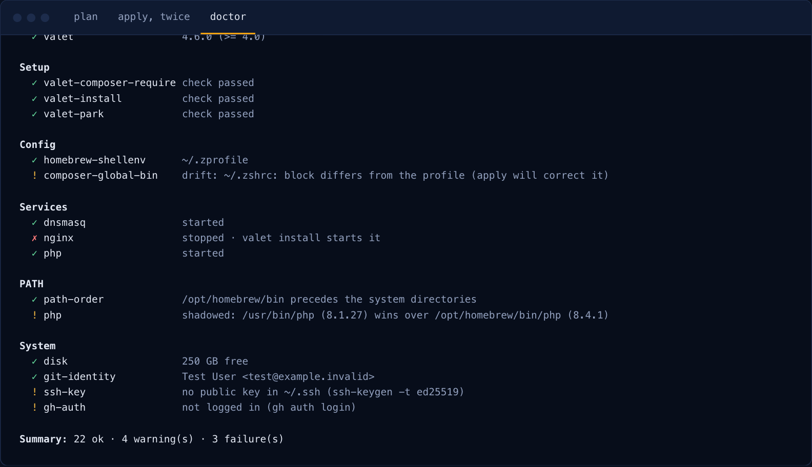

# Case study: devbox, a bootstrap you can run twice

## The problem

I look after IT for a small organisation. Every few months someone gets a new laptop: an intern, a contractor, a developer whose machine died. Setting one up takes a long time, mostly spent remembering what the last one had. The same story shows up in agencies and small product teams.

Three things hurt:

1. **It takes long, and the knowledge lives in a person.** The real recipe is in someone's shell history.
2. **Machines drift.** Two developers on one project end up with different PHP versions, and a stale `/usr/bin` tool shadows the Homebrew one. "Works on my machine" starts as a PATH problem.
3. **The scripts that exist are not safe to re-run.** The classic bootstrap script does `echo 'export PATH=...' >> ~/.zshrc`. Run it twice and you have two copies. Run it after an edit and you have no idea what it will overwrite.

The coping strategies are a wiki page that rots, a Brewfile that covers packages but not the shell config, or a golden image that nobody can afford to maintain.

## Goals and non-goals

Goals:

- A new Mac gets to a known state from a few small text files in git.
- Re-running is always safe and shows what it would do first.
- When the machine has drifted, a command says what and why, with a non-zero exit code a script can use.
- I can test it without installing anything.

Non-goals: Linux or Windows support, managing every dotfile, removing things you installed by hand, replacing a configuration manager like Ansible, or being a package manager. Homebrew does that.

## What I built

`devbox` is a Bash program with a `plan`, `apply`, `doctor`, `list`, `profiles`, `export` and `version` command. Profiles are text manifests that `include` each other: base tools, PHP with Laravel Valet, Python with uv, Node with fnm, the Salesforce CLI, data tools, VS Code, and a small set of macOS defaults.

The screenshot is real output of `devbox doctor`, from the mocked machine the tests use. An old PHP shadows Homebrew's, `jq` is too old, nginx is stopped, and someone edited a managed block. The docs site is generated from the manifests, so the profile pages cannot drift from them.

## Design decisions and trade-offs

**1. Idempotency is the core property, so every step has a check.**
A step is a check, an apply and a description of the command. `plan` and `doctor` only use the check. `apply` runs only unsatisfied steps and then re-runs the check; a step that "succeeds" but still fails its check is reported as a failure. The alternative was a linear script with `if ! command -v x` guards sprinkled through it. That works until the first step with no obvious guard, such as "this line is in my rc file." Making the check a required part of the data model means there is no step you cannot re-run. A test applies every bundled profile, applies again, and asserts the mock's mutation log is empty.

**2. Managed blocks, not appended lines.**
Shell config is the hard case. Appending is not idempotent; rewriting the whole file is not polite. A block between markers can be replaced in place and leaves everything else byte-for-byte alone. Two details cost me time. Marker matching has to be exact: my first version matched by prefix, so a block called `php` would have matched `php-path`. And if the markers are damaged (begin without end, or two copies), the right move is to refuse: the step is marked blocked and nothing is changed. Writes go through the existing path with `cat >`, not `mv`, so a dotfile that is a symlink into a dotfiles repo stays a symlink. The trade-off is that a crash mid-write could truncate the file, which is why a backup is taken first.

**3. A plan/apply split, with plan as the default.**
Typing `devbox` with no arguments runs `plan`. I wanted the safe action to be the lazy one. Plan prints the exact command for each change, and `--dry-run` on apply is just plan. The tests assert that a dry run leaves the mock's mutation log empty and creates no files under `$HOME`. The cost is that checks run during plan, so they must be read-only. That is a documented rule for `cmd` steps, and I cannot enforce it in a Bash `check` string.

**3b. Bash 3.2, not "bash 5 with a re-exec".**
macOS ships bash 3.2. The alternative was to require Homebrew bash and re-exec into it, but a bootstrap tool should not need the thing it installs. I chose 3.2 and paid for it: no associative arrays (steps are packed strings split on an ASCII unit separator), empty arrays break `set -u` unless expanded as `${a[@]+"${a[@]}"}`, and a bug where an empty profile crashed `plan` came from exactly that. The tests run on the system bash.

**4. Profiles are parsed, never sourced.**
A shell-sourced `profile.sh` would be simplest, but then a profile can do anything at plan time. The format is line-based, a small tokenizer handles quotes, and nothing is expanded. Unknown kinds and options, bad versions, a block file outside `~`, and include cycles are rejected with `file:line` messages. `cmd` strings are still code, run with `bash -c` after being shown in the plan, and the docs say so. Parsing safely does not make the profile trustworthy; it makes the review honest.

**5. No `curl | sh`.**
Homebrew is a prerequisite and devbox says where to get it. For anyone who needs an upstream installer, an `installer` step downloads over https, verifies a pinned sha256, and only then runs the file. It is refused without `--yes`. None of the bundled profiles uses one, and a test enforces that. The alternative, pinning Homebrew's install script checksum, would go stale and fail for no good reason.

**6. Test a machine-mutating tool without mutating a machine.**
The mock layer is the part I would reuse. Tests run devbox with `env -i` and a `PATH` that contains symlinks to a short list of real utilities, mock binaries, and a fake Homebrew prefix. There is no real `brew`, `php` or `git` to reach. The mock `brew` keeps installed state in a file and `install` appends to it, so apply behaves idempotently against it. Every mutating mock writes to one log, which is how "dry run changed nothing" is a one-line assertion. `uname` and `id` are mocks too, so the "refuses root" and "refuses non-macOS" tests need no real root and run on Linux CI. One subtlety: doctor's shadowing check compares real paths, and my first mocks were all symlinks to one script, so Homebrew's `php` and the "old" `php` resolved to the same file and no shadowing was detected. The mock installs are now separate wrapper files.

## How it's kept correct and safe

- **Tests:** 264 bats tests pass locally (macOS, bash 3.2.57). They use bats-core, cover the properties above, and run on `ubuntu-latest` and `macos-latest`, the latter also on the system bash.
- **Static checks:** ShellCheck is clean on `bin/`, `lib/`, `scripts/`, helpers and mocks. `shfmt` is not set up.
- **Safety rules:** refuses root and non-macOS; file edits only under `~`; backups before any file change; an append-only log; restore script for macOS defaults, built from the values read before the change; installer checksums.
- **Failure modes:** a failed step stops the run (or continues with `--keep-going`) and exits 1; because steps are idempotent, fixing the cause and re-running resumes. Blocked steps stop the apply before anything is changed.
- **Docs cannot drift:** the profile pages, guide tables and Brewfiles are generated from the manifests, and CI regenerates them and fails on a diff. The terminal sessions on the landing page are captured from the real program.

## What I'd do differently / what's next

- Run it on a clean Mac first. That is the biggest gap and I would expect the mocks to have missed things.
- Valet is the riskiest profile. I wrote the steps from its documented behaviour (`composer global require laravel/valet`, `valet install`, `valet park`, root-owned services) but have not run them. In particular, whether `brew services list` run as a normal user shows root-owned services is an assumption.
- A `revert` command that replays a backup directory. Today the backups and restore script are there, but the replay is manual.
- Version pins per profile, so two machines built a month apart get the same versions.
- `export` only captures packages. Capturing dotfiles safely is a bigger question than it looks.

## Status

Portfolio build. It runs locally, and everything in the test suite and docs is produced against a mocked machine with fixture versions. It has not been run end to end on a clean Mac. No real installs were exercised from this environment, and nothing here claims users or deployments.
